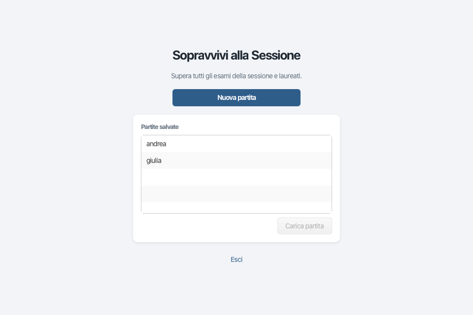
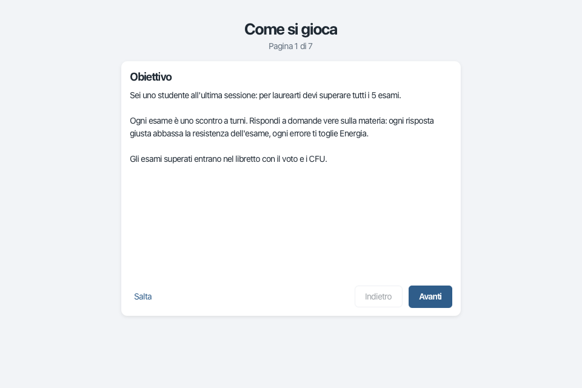
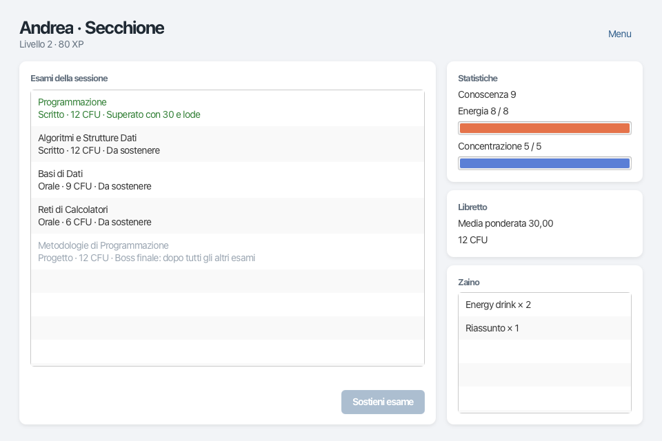
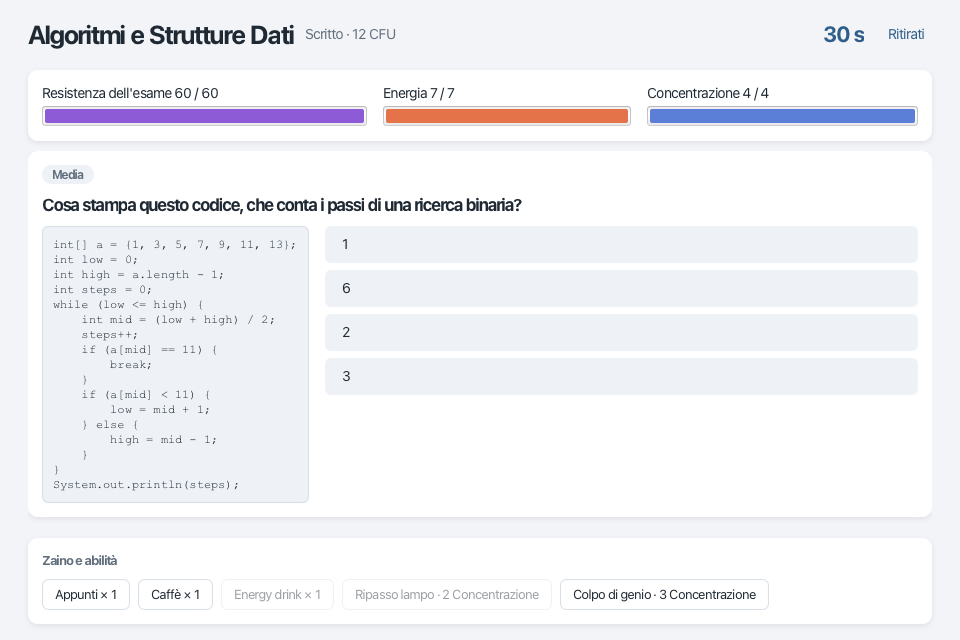
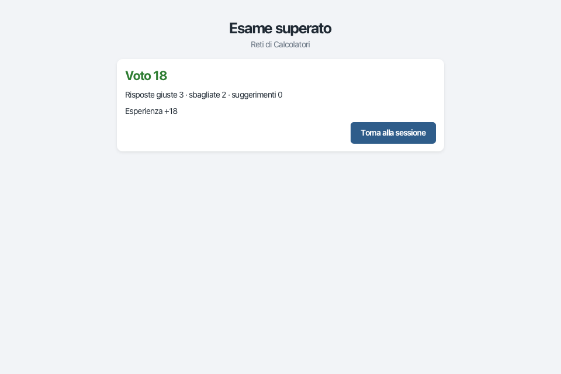
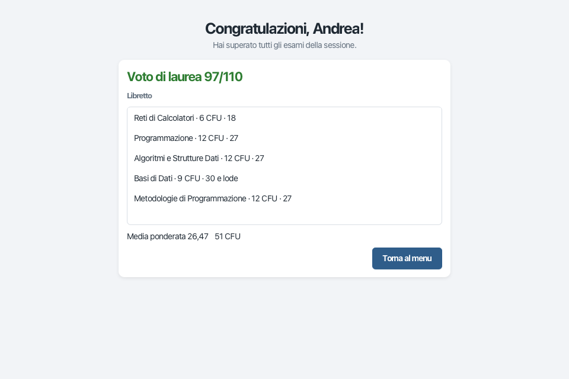

# 📌 Sopravvivi alla Sessione

Gioco di ruolo in Java 25 con interfaccia JavaFX, sviluppato come progetto d'esame di
**Metodologie di Programmazione** (UNICAM). Lo studente deve superare una sessione d'esami:
ogni esame è uno scontro a turni in cui si "combatte" rispondendo a domande vere sulla
materia, con statistiche, oggetti e abilità che influenzano lo scontro. Gli esami superati
entrano nel libretto con voto e CFU; superata tutta la sessione, lo studente si laurea.

| Menu | Come si gioca | Sessione |
|---|---|---|
|  |  |  |
| **Esame** | **Esito** | **Laurea** |
|  |  |  |

---

## 🚀 Come compilare ed eseguire

### Requisiti
- **Java 25.** Se non è installato, Gradle lo scarica da solo grazie alla toolchain
  configurata in `build.gradle.kts`; per avviare il wrapper serve comunque un JDK 17 o
  superiore.
- **Gradle non va installato:** il progetto include il Gradle Wrapper (`./gradlew`, su
  Windows `gradlew.bat`).
- JavaFX non va installato: è una dipendenza della build.

### Comandi
```bash
git clone https://github.com/Zuppa-hub/SurviveTheSession.git
cd SurviveTheSession

./gradlew build   # compila ed esegue tutti i test
./gradlew run     # avvia il gioco
./gradlew test    # solo i test
```

Le partite si salvano da sole alla fine di ogni esame in
`~/.sopravvivi-alla-sessione/saves/`, un file JSON per partita.

---

## 🎮 Come si gioca, in breve

1. **Nuova partita:** scegli il nome e il profilo (Secchione, Pendolare o Nottambulo), che
   decide Conoscenza, Energia e Concentrazione iniziali. La prima volta il gioco mostra le
   pagine di **Come si gioca**, sempre raggiungibili dal menu e dalla sessione.
2. **Sessione:** scegli un esame da sostenere. L'ultimo esame è il **boss finale** e si
   sblocca solo dopo tutti gli altri.
3. **Esame:** ogni risposta giusta abbassa la resistenza dell'esame, ogni errore toglie
   Energia. Negli scritti c'è un timer, all'orale le domande si fanno più difficili dopo un
   errore, nel progetto gli errori costano di più. Puoi usare oggetti (Caffè, Appunti,
   Riassunto, Energy drink) e abilità, oppure ritirarti.
4. **Esito:** se superi l'esame ricevi un voto, esperienza e, con un buon voto, oggetti;
   l'esperienza fa salire di livello e migliora le statistiche.
5. **Laurea:** superati tutti gli esami, il libretto mostra la media ponderata e il voto di
   laurea.

Le regole complete, con i numeri, sono nella pagina
[Funzionalità](https://github.com/Zuppa-hub/SurviveTheSession/wiki/Funzionalita) della Wiki e
nella schermata Come si gioca.

---

## 🗂️ Struttura del progetto

Package base: `it.unicam.cs.mpgc.rpg127295`

| Package       | Responsabilità                                                              |
|---------------|-----------------------------------------------------------------------------|
| `model`       | Entità e stato del gioco; non dipende da nessun altro package               |
| `engine`      | Regole e flusso della partita; definisce le interfacce che usa (es. cataloghi) |
| `persistence` | Implementazioni: lettura dei contenuti XML e salvataggi JSON                |
| `ui`          | Interfaccia JavaFX: input e output verso il giocatore                       |
| `app`         | Punto di ingresso (`Main`) e assemblaggio dei componenti                    |

I contenuti (esami, domande, profili, oggetti) sono file XML in
`src/main/resources/content`, validati da XML Schema all'avvio.

---

## 📚 Documentazione

- **[Wiki](https://github.com/Zuppa-hub/SurviveTheSession/wiki):** funzionalità,
  architettura, classi, SOLID, Clean Code, strutture dati, modelli di esecuzione,
  persistenza, interfaccia grafica, testing, estendibilità, strumenti. I sorgenti sono in
  [`docs/wiki`](docs/wiki/Home.md).
- **[Documento di design](docs/design.md):** la fonte di verità delle scelte.

---

## 🤖 Uso di strumenti di AI

Il progetto è sviluppato con il supporto di **Claude Code** (Anthropic), che ha scritto
codice, test e documentazione, e di **Claude in chat**, usato per rivedere progettazione e
pull request. Il documento di design, la scelta di cosa accettare, i test a mano e la
revisione di ogni PR sono miei; dal 12/11, per i tempi di consegna, le soluzioni delle singole
issue le ha decise e implementate Claude Code, nel rispetto del design.

Il dettaglio è nella pagina
[Uso dell'AI](https://github.com/Zuppa-hub/SurviveTheSession/wiki/Uso-dell-AI) della Wiki e,
sessione per sessione, nel registro in [`docs/ai-log/`](docs/ai-log/README.md).
