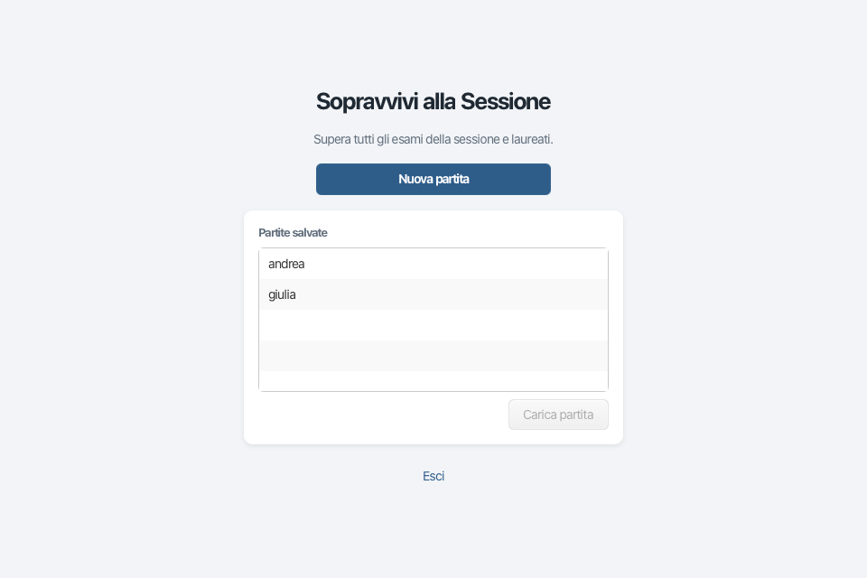
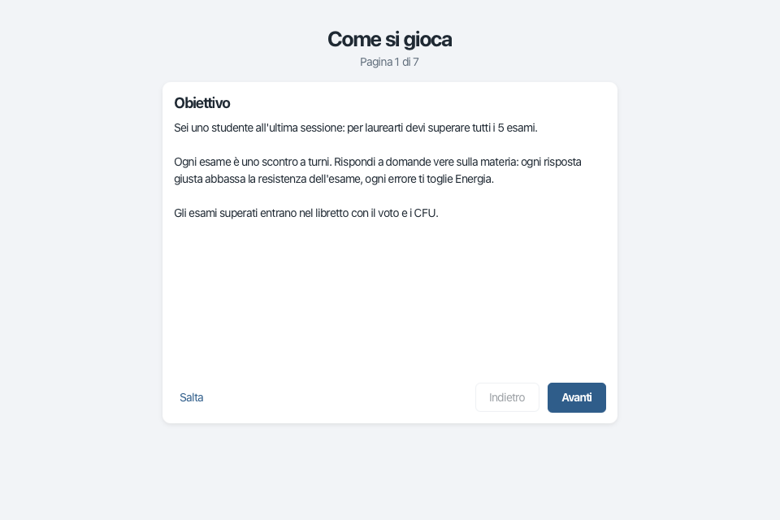
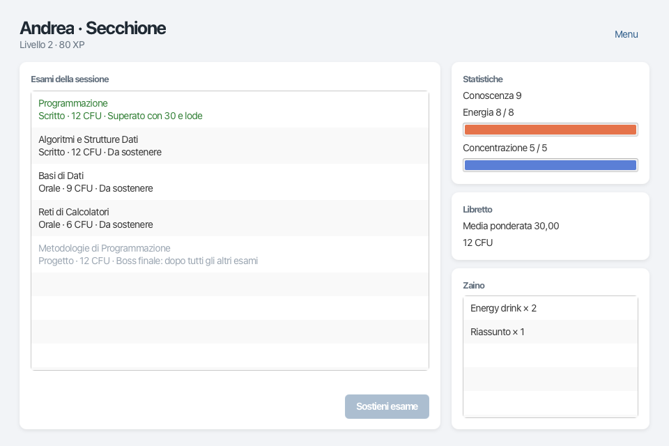
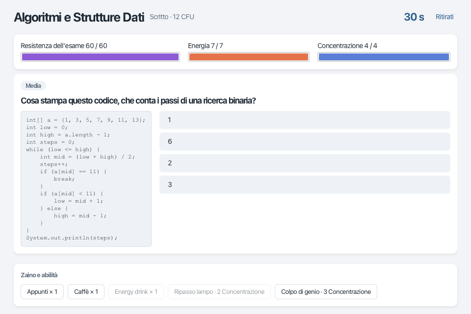
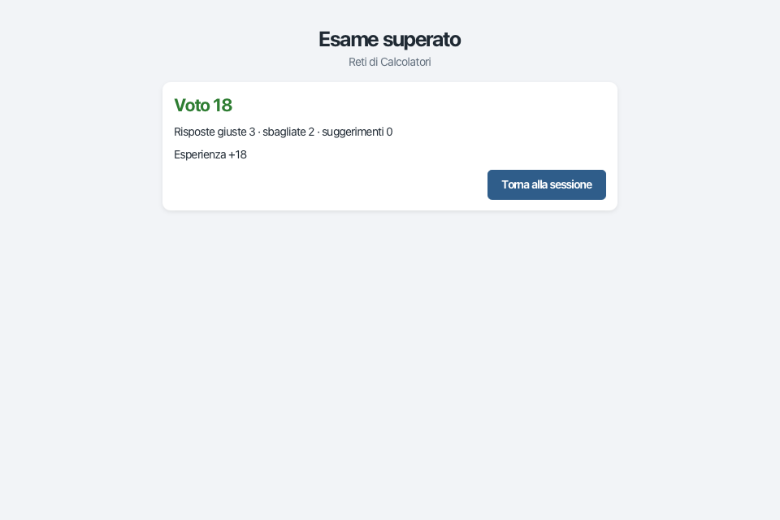
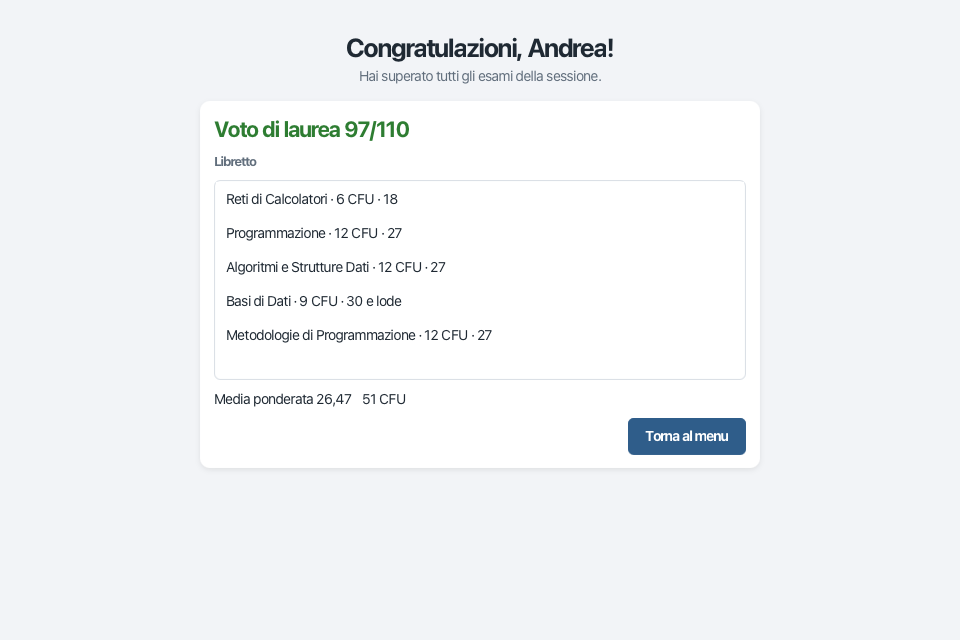

# Interfaccia grafica

L'interfaccia è in JavaFX: ogni schermata è un file FXML (la struttura), un controller (le
reazioni agli eventi) e un unico foglio di stile, `styles.css` (l'aspetto). La grafica è
volutamente semplice: sfondo chiaro, schede bianche, un solo colore d'accento.

## Le schermate

Le immagini si rigenerano da un programma che apre le schermate con i contenuti veri e ne
salva l'istantanea (`Scene.snapshot`), senza mostrare la finestra.

| Schermata | File | Cosa fa |
|---|---|---|
| Menu | `menu.fxml`, `MenuController` | nuova partita, Come si gioca, elenco delle partite salvate e caricamento, uscita |
| Come si gioca | `how-to-play.fxml`, `HowToPlayController` | sette pagine con Avanti e Indietro: obiettivo, statistiche, tipi d'esame, oggetti e abilità, voto, ricompense e livelli, boss finale, laurea e salvataggi |
| Nuova partita | `new-game.fxml`, `NewGameController` | nome del giocatore e scelta del profilo, con descrizione e statistiche iniziali |
| Sessione | `session.fxml`, `SessionController` | esami della sessione con il loro stato, statistiche, libretto, zaino, "Sostieni esame" |
| Esame | `exam.fxml`, `ExamController` | domanda (con lo snippet di codice se c'è), opzioni o campo di testo, timer, barre di resistenza, Energia e Concentrazione, oggetti e abilità, "Ritirati" |
| Esito | `outcome.fxml`, `OutcomeController` | voto o bocciatura, risposte, ricompense e livelli; poi sessione o laurea |
| Laurea | `graduation.fxml`, `GraduationController` | libretto, media ponderata, CFU e voto di laurea su 110 |

## Come si gioca: testo scritto a mano, numeri letti dalle regole
La schermata compare da sola la prima volta che si apre Nuova partita senza partite salvate,
prima della scelta del profilo; poi si apre dal menu, dalla nuova partita e dalla sessione. Il
navigatore le passa l'azione da eseguire alla chiusura, così le stesse pagine portano alla
scelta del profilo, al menu o alla sessione.

Il testo delle pagine sta in `HowToPlay`, ma **nessun numero delle regole è scritto a mano**:
- `GameService.guide()` restituisce un `GameGuide` con le stesse istanze che usano le partite
  (`BattleRules`, strategie, `ProgressionRules`, `RewardPolicy`, `GradeCalculator`, abilità,
  kit iniziale, sessione e profili), costruito da `GameAssembly`;
- i numeri che le regole espongono si leggono direttamente (secondi del Caffè, Energia persa
  per difficoltà, costo delle abilità, esperienza per salire di livello...);
- quelli che non espongono si chiedono alle regole: la percentuale per superare un esame è la
  più bassa per cui `GradeCalculator` dà un voto, il voto da cui arrivano oggetti è il più
  basso per cui `RewardPolicy` ne dà almeno uno (`Grade.all()` elenca i voti senza riscrivere
  l'intervallo).

Se il bilanciamento cambia, cambiano anche le pagine. `HowToPlayTest` lo verifica con regole
dai valori insoliti (97 secondi, ×59...), che devono comparire nel testo. Per lo stesso motivo
la descrizione del Caffè in `items.xml` non dice più "15 secondi".

## Stile: un foglio, variabili e varianti
- **Un solo `styles.css`** per schermate e dialoghi. I colori sono variabili (looked-up colors
  su `.root`, come `-color-accent`); JavaFX non ha variabili per le dimensioni, quindi
  spaziature e margini stanno in poche classi di layout (`.screen`, `.page`, `.header`,
  `.card`, `.stack`, `.row`, `.actions`...) e non negli FXML.
- **Due impaginazioni.** Le schermate "pagina" (menu, nuova partita, come si gioca, esito,
  laurea) sono una colonna centrata con titolo e sottotitolo in alto; sessione ed esame sono a
  tutta finestra con l'intestazione a sinistra. Titoli, sottotitoli e margini sono gli stessi.
- **Varianti di pulsante usate allo stesso modo ovunque:** `primary` per l'azione principale
  della schermata (al massimo una), `secondary` per le altre (anche oggetti e abilità), `link`
  per uscire dalla schermata (Menu, Esci, Indietro, Ritirati), `option` per le risposte.
- **Dialoghi.** `Alerts.dialog` aggiunge il foglio di stile al `DialogPane` e una classe per il
  tipo (`error`, `warning`) che colora l'intestazione.
- **Liste senza strisce e stati vuoti spiegati.** Le righe vuote delle `ListView` non si
  disegnano; una lista vuota mostra un testo che dice perché e cosa fare (`EmptyStates`): lo
  zaino vuoto dice da che voto arrivano gli oggetti, letto dalla `RewardPolicy`.
- **Tooltip.** Nello zaino e tra le azioni dell'esame la descrizione dell'oggetto è il tooltip
  (`InventoryRow`, `BattleAction`).

Ogni schermata è stata controllata con uno screenshot prima e dopo, allegati alla PR.

## Controller sottili
I controller non contengono regole di gioco: traducono un clic in una chiamata all'engine e
mostrano il risultato. Ad esempio la schermata della sessione non decide quali esami si
possono sostenere: lo chiede a `Game.availableExams()`.

Quello che serve a mostrare i dati, ma non dipende da JavaFX, sta in classi separate testate con
JUnit:
- **`ExamRow`**: lo stato di ogni esame (superato con il voto, da sostenere, oppure bloccato
  perché è il boss finale) e le etichette in italiano. Il tipo d'esame si traduce con una
  `EnumMap`, come nel resto del progetto.
- **`SlotNames`**: il nome del salvataggio ricavato dal nome del giocatore ("Àndrea Cazzàto" →
  `andrea-cazzato`), sempre valido per la regola degli slot della #9.
- **`BattleAction`**: ogni oggetto posseduto (in ordine di nome) e ogni abilità come pulsante,
  con etichetta, descrizione e stato. Se si può usare lo decide lo scontro con
  `ExamBattle.canUse`: la schermata non sa che il Caffè serve solo con il timer o che gli
  Appunti vogliono almeno tre opzioni sbagliate.
- **`AnswerFeedback`**: il messaggio dopo una risposta (giusta, sbagliata, tempo scaduto). La
  domanda successiva compare subito, quindi il messaggio dice "Domanda precedente: ..." e sta in
  alto nella scheda, accanto alla difficoltà, non sotto le opzioni della nuova domanda.
- **`StatTexts`**: i testi mostrati in più schermate (Energia e Concentrazione come
  "valore / massimo", resistenza, media ponderata, CFU, voto di laurea su
  `Graduation.GRADUATION_SCALE`) e la frazione per le barre, scritti una volta sola.
- **`Labels`**: i nomi italiani degli enum mostrati (tipo d'esame, difficoltà della domanda),
  in `EnumMap`; un valore senza etichetta lancia un'eccezione invece di restituire `null`.
- **`ErrorMessages`**: i testi italiani dei dialoghi d'errore (caricamento, salvataggio,
  contenuti non validi). Le eccezioni restano in inglese nel codice: il loro messaggio va nel
  log, mai al giocatore.
- **`OutcomeSummary`**: titolo, voto e righe dell'esito, ricavati dall'`ExamReport`; i titoli
  per `BattleResult` stanno in una `EnumMap`.
- **`GraduationSummary`**: righe del libretto, media, CFU e voto di laurea, tutti calcolati
  dall'engine (`Game.graduationGrade()`, `Transcript.weightedAverage()`).

Così le parti con una logica sono verificate dai test, e i controller restano codice di
collegamento.

## Chi crea i controller
Gli FXML non hanno `fx:controller`. È `ViewNavigator` a creare ogni controller passandogli nel
costruttore quello che usa (il navigatore, la partita o il servizio delle partite) e a
consegnarlo a `FXMLLoader` con `setController`. Niente stato statico, niente framework di
iniezione: le dipendenze di un controller si leggono nel suo costruttore. `ViewNavigator`
carica anche il foglio di stile una volta sola, sulla scena.

## La schermata d'esame
`ExamController` implementa `BattleListener` ed è il listener passato a
`Game.startExam(esame, listener)`. Il navigatore prima carica la vista e poi avvia l'esame,
perché la prima domanda arriva subito, dentro `startExam`.

- **Lo scontro si legge dalla partita.** Il controller non tiene un campo con l'`ExamBattle`:
  lo chiede a `Game.currentBattle()`, che lo contiene già quando arriva la prima domanda e
  torna vuoto a esame finito. Così non c'è un campo che resta `null` fino al ritorno di
  `startExam`.
- **Ogni notifica aggiorna la vista.** Nuova domanda ed effetto applicato ridisegnano barre,
  domanda e pulsanti dallo stato dello scontro (`BattleState`); il tick aggiorna solo il
  timer, che sotto i 5 secondi diventa rosso.
- **Categoria della domanda senza `instanceof`.** Una domanda a scelta ha delle opzioni
  (`PresentedQuestion.options()`), una da completare no: pulsanti nel primo caso, campo di
  testo nel secondo. Dopo gli Appunti le opzioni sono due di meno, e la vista le ridisegna.
- **Lo snippet di codice.** `Question.codeSnippet()` è vuoto di default e
  `CodeOutputQuestion` lo ridefinisce. La schermata lo mostra se c'è, senza chiedere il tipo
  concreto della domanda (stesso principio del `QuestionVisitor`). Lo snippet sta a sinistra
  e le opzioni a destra: in colonna, con lo snippet più lungo (17 righe), la quarta opzione
  restava fuori dalla finestra. Un programma eseguito a mano ha misurato tutte le 78 domande a
  960 × 640: nessuna richiede lo scroll.
- **Tempo scaduto.** Per lo scontro il tempo scaduto è una risposta sbagliata, ed è giusto
  così per il voto. Al giocatore però va detto: il controller alza un flag mentre passa la
  risposta allo scontro, quindi una risposta sbagliata arrivata senza il flag è una scadenza.
  La differenza resta nella UI perché serve solo al messaggio: portarla nell'engine vorrebbe
  dire un terzo esito della risposta che nessuna regola userebbe.
- **Partite salvate illeggibili.** Se la cartella dei salvataggi non si può leggere, menu e
  nuova partita chiedono l'elenco a `ViewNavigator.savedGames()`, che mostra un avviso in
  italiano e prosegue senza partite salvate, invece di fermarsi con un'eccezione.
- **Il timer è reale.** Le notifiche arrivano dal thread del timer attraverso
  `Platform::runLater`, quindi il controller e lo scontro vengono toccati solo dal thread di
  JavaFX (vedi [Modelli di esecuzione](Modelli-di-esecuzione)).

## Esito e laurea
Chi mostra l'esito è un `GameListener`: `ViewNavigator.openGame` lo registra una volta per
partita, quando la partita viene creata o caricata. A fine esame `Game` applica l'esito
(libretto, ricompense, livelli), avvisa i listener in ordine di registrazione (prima
`AutoSave`, che salva, poi la UI) e la UI mostra la schermata dell'esito con l'`ExamReport`.
La schermata d'esame non fa niente alla fine: non deve sapere che dopo c'è l'esito.

Dall'esito si torna alla sessione, oppure, se la sessione è completa (`Game.canGraduate()`),
si va alla laurea.

## La UI dipende dall'engine, non da `app`
Per creare o caricare una partita la UI usa l'interfaccia **`GameService`** (profili, partite
salvate, nuova partita, caricamento), definita nel package `ui` dove viene usata. La
implementa `GameAssembly`, la composition root in `app`. Le dipendenze vanno quindi
`app → ui → engine → model`, senza cicli: è lo stesso principio (DIP) usato per i repository.

## Avvio e chiusura: `GameApplication`
`Main` lancia `GameApplication` (sottoclasse di `Application`). Una classe di avvio separata,
che non estende `Application`, permette di avviare il gioco dal class path senza
configurazioni dei moduli.

- **`start`** carica i contenuti, crea lo scheduler del timer e `GameAssembly`, e mostra il
  menu. Se i contenuti non sono validi compare una finestra d'errore con il messaggio della
  `ContentException` e il gioco si chiude (fail fast, come prima in console).
- **`Platform::runLater`** è l'esecutore delle notifiche del timer: ogni secondo e ogni
  scadenza arrivano sul thread dell'interfaccia, così lo scontro viene toccato da un solo
  thread (vedi [Modelli di esecuzione](Modelli-di-esecuzione)).
- **`stop`** chiama `scheduler.shutdownNow()`: lo scheduler l'ha creato l'applicazione, quindi
  è l'applicazione a chiuderlo.

## Salvataggio fallito: un avviso, non un errore
Se un salvataggio automatico fallisce (disco pieno, cartella non scrivibile), il callback della
#9 mostra un avviso con `Alert.show()`, che non blocca: il giocatore legge il messaggio e la
partita continua. L'avviso dice cosa controllare (spazio sul disco, cartella scrivibile) e che
il gioco riproverà alla fine del prossimo esame; il dettaglio tecnico va nel log.

## Come è stato verificato
I controller non hanno test automatici: un test dell'interfaccia grafica richiederebbe una
libreria apposita e un display. Sono verificati in due modi:
- le classi con logica (`ExamRow`, `SlotNames`, `BattleAction`, `AnswerFeedback`, `Labels`,
  `ErrorMessages`, `InventoryRow`, `EmptyStates`, `StatTexts`, `GameGuide`, `HowToPlay`, `OutcomeSummary`,
  `GraduationSummary`, `GameAssembly` come `GameService`) hanno test JUnit;
  i test della UI condividono una partita di prova (`TestGames`) con timer manuale;
- un programma eseguito a mano, fuori dal repository, ha giocato con i contenuti veri e il
  timer vero: ha controllato che il timer scendesse (30 s → 28 s dopo due secondi e mezzo),
  risposto alle domande dai pulsanti e dal campo di testo, visto lo snippet di codice,
  l'esito e il salvataggio automatico, il ritiro da un esame e la schermata di laurea, senza
  eccezioni.
